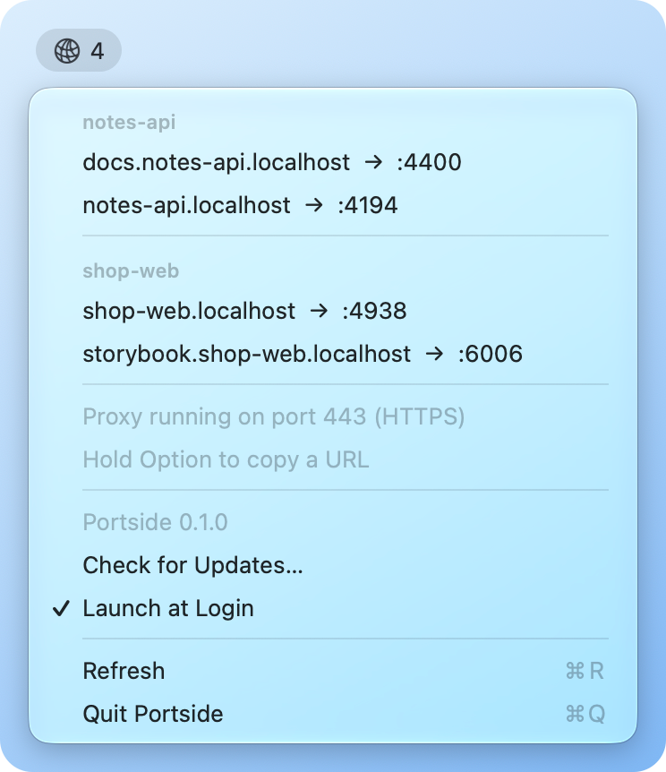

  

<h1 align="center">Portside</h1>

  All your <a href="https://portless.sh">portless</a> dev URLs, one click away in the macOS menu bar.

  <a href="https://github.com/torjusb/Portside/releases/latest"><strong>Download Portside</strong></a>

  

## What it does

If you run your local projects with portless, Portside shows every URL that is live right now, so you never have to remember a name or look one up.

- **Always up to date.** The list changes as you start and stop projects.
- **Grouped by project.** For example, `api.shop.localhost` and `web.shop.localhost` both appear under `shop`.
- **One click to open.** Click a URL to open it in your browser. Hold Option and click to copy it instead.
- **A count at a glance.** The menu bar icon shows how many URLs are live.
- **Updates itself.** Portside checks for new versions once a day and installs them for you.

## Install

You need macOS 15 or later, and [portless](https://portless.sh) installed and running.

1. Download `Portside.dmg` from the [latest release](https://github.com/torjusb/Portside/releases/latest).
2. Open the file and drag Portside into your Applications folder.
3. Open Portside from Applications. The first time, macOS blocks it.
4. Open **System Settings → Privacy & Security**, find the message about Portside, and click **Open Anyway**.

You only do step 4 once. macOS shows the warning because Portside is a free, independent app that is not registered with Apple's paid developer program.

To start Portside every time you log in, open its menu and select **Launch at Login**.

## Updates

Portside updates itself. To check now, open its menu and select **Check for Updates**. The menu also shows which version you have.

## Contributing

Portside is open source. To build it yourself or help out, see [AGENTS.md](AGENTS.md).
